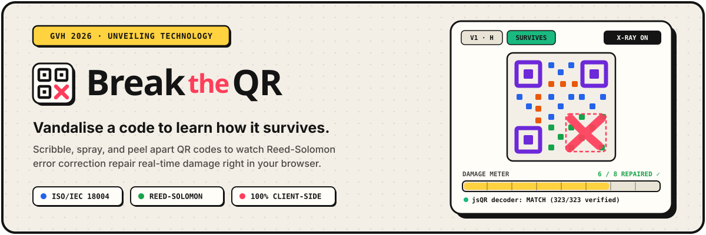
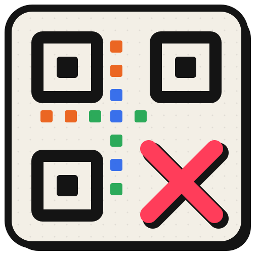

<p align="center">
  
</p>

<p align="center">
  <a href="https://venstqs.github.io/BreaktheQR/"></a>
  <a href="https://github.com/venstqs/BreaktheQR/actions/workflows/ci.yml"></a>
  
  
  <a href="LICENSE"></a>
</p>

<p align="center">
  <strong>Scribble on a QR code until it breaks — and watch the hidden backup system that kept it alive until then.</strong>
</p>

---

## Unveiling the Tech Behind Every Scan

You scan QR codes every day, yet most people never see what is actually inside those tiny black-and-white squares — or why a scratched, coffee-stained, or logo-covered code still opens a link instantly.

**Break the QR** is a hands-on, browser-based interactive lab built for **Global Virtual Hackathon 2026 (Theme: _Unveiling Technology_)**. Instead of reading dry specs, you generate or scan any QR code, peel apart its hidden structural layers, trace its zig-zag read order, and grab a brush or spray can to **vandalise it in real time** until Reed-Solomon error correction finally hits its breaking point.

| Metric | Detail |
| :--- | :--- |
| **30% Resilience** | A Level-H QR code can lose up to ~30% of its codewords and still scan cleanly |
| **323 / 323 Verified** | Custom ISO/IEC 18004 encoder round-trips every Version 1–10 × Level × Mask through `jsQR` |
| **600 / 600 Trials** | Live damage meter matches the independent `jsQR` decoder on 600/600 random damage trials |
| **0 Bytes Uploaded** | Plain HTML, CSS & JavaScript — no build step, no backend, camera stays 100% on-device |

---

## The 8-Stage Interactive Lab

| # | Stage | What You Can Do |
| :-: | :--- | :--- |
| **1** | **Make or Scan** | Type any text/URL, pick error correction (**L / M / Q / H**) and grid size, or scan a live code via camera/photo (`jsQR`). |
| **2** | **Layer View** | Every module is color-coded by role (Finder Eyes, Timing, Format, Data, Error Correction). Peel layers away and tap any square for a plain-English explanation. |
| **3** | **Read Order** | Watch an animated zig-zag byte path traverse the matrix codeword by codeword, revealing the exact characters each byte carries. |
| **4** | **Vandal Mode** | Wreck your code with a brush, spray paint, emoji/logo stickers, cleaner, undo, or one-click real-world "accidents" (center logo, coffee stain, torn corner). |
| **5** | **Live Damage Meter** | Always visible below the stage: tracks *"X of Y repairable codewords used"*, per-block health bars, and compares our prediction side by side with `jsQR`. |
| **6** | **Break Point** | The moment decoding fails, a **BROKEN** stamp appears, corrupted codewords flash red, lost characters are struck out, and plain-language reasons explain why. |
| **7** | **Level Switch** | Apply your exact vandalism across **L (7%)**, **M (15%)**, **Q (25%)**, and **H (30%)** side by side to see how redundancy changes survival. |
| **8** | **Graffiti QR & Link X-Ray** | Design scannable custom-colored QR art with scanner-contrast swatches, export PNGs, and inspect links safely with **Check before you tap** (Link X-Ray). |

**Extras included:** X-Ray overlay (outlines damaged codewords & flipped modules), per-level survival record tracker, Version 1–10 explorer, and an APA 7 research & references section.

---

## Architecture & How It Works

No frameworks, no bundlers, no external APIs — just clean, readable vanilla code:

| File | Role | Author |
| :--- | :--- | :--- |
| [`js/qr-core.js`](js/qr-core.js) | Complete QR encoder (ISO/IEC 18004, byte mode, versions 1–10, levels L/M/Q/H, all 8 masks) + **module role map** + **codeword map** | Team (CIS) |
| [`js/qr-damage.js`](js/qr-damage.js) | **Live damage meter**: samples canvas luminance, detects flipped modules, maps them to codewords, checks per-block repair limits (`floor(backup / 2)`), inspects finder/format zones, and generates plain-language explanations | Team (CIS) |
| [`js/app.js`](js/app.js) | Multi-canvas stage, layer peeling, zig-zag read-order animation, vandal & graffiti tools, level comparison, and camera scanner | Team (CIS) |
| [`js/link-xray.js`](js/link-xray.js) | *"Check before you tap"* URL & quishing safety inspector | Team (CIS) |
| [`tests/encoder.test.js`](tests/encoder.test.js) | Automated verification suite (323 encoder round-trips + 600 damage-meter vs `jsQR` trials) | Team (CIS) |
| [`vendor/jsQR.js`](vendor/jsQR.js) | Independent QR decoder used to double-check our meter in real time (Apache-2.0) | Third-party |

### The Real-Time Verification Loop

1. On every brush stroke, the stage composites the clean QR matrix with the vandal canvas layer.
2. `qr-damage.js` samples the center of every module (dark if luminance < 50%) and diffs it against the original encoded matrix.
3. Any codeword containing at least one flipped module counts as damaged. Each Reed-Solomon block survives while:
   $$\text{damaged} \le \left\lfloor \frac{\text{backup codewords}}{2} \right\rfloor$$
4. The exact same composited image is simultaneously decoded by `jsQR`, proving the teaching model against a real-world scanner on every stroke.

---

## Quick Start

### Run Locally

Serve the folder through any static HTTP server (required for camera access via `localhost` or `https://`):

```bash
npm start
# opens on http://localhost:8080
```

Or using Python:

```bash
python -m http.server 8080
```

### Run the Test Suite

Verify all 323 encoder round-trips, codeword-to-module mapping, and 600 random damage trials:

```bash
npm test
```

### Deploy on GitHub Pages

1. Go to **Settings → Pages** in this repository.
2. Under **Build and deployment**, select **Deploy from a branch** → `main` → `/ (root)`.
3. Your live lab will publish to `https://venstqs.github.io/BreaktheQR/` (`.nojekyll` is already included).

---

## Limits We State Openly

- **Teaching model vs. real optics:** Real-world scanners can also fail from motion blur, glare, perspective warp, or low contrast — noted in the app, though not fully simulated.
- **Per-codeword damage model:** In rare edge layouts, a physical decoder's Reed-Solomon erasures may behave slightly differently, which is why every stroke is double-checked live against `jsQR`.
- **Finder eye heuristics:** Eye damage uses a clear pedagogical threshold; real finder-pattern detection is more nuanced.
- **Privacy by design:** Zero scanned content or camera frames are uploaded or stored anywhere.
- **Safety advice:** The Link X-Ray / quishing tip is general educational guidance, not a standalone security product.

---

## Credits & License

<p align="left">
  
  <strong>Break the QR</strong> — Global Virtual Hackathon 2026 entry by <strong>CIS</strong>.<br />
  Licensed under the <a href="LICENSE">MIT License</a>.<br />
  <sub><code>jsQR</code> © Cosmo Wolfe, Apache License 2.0 (<a href="vendor/jsQR-LICENSE.txt">vendor/jsQR-LICENSE.txt</a>). QR Code is a registered trademark of DENSO WAVE INCORPORATED. Research references are listed in-app (APA 7).</sub>
</p>
